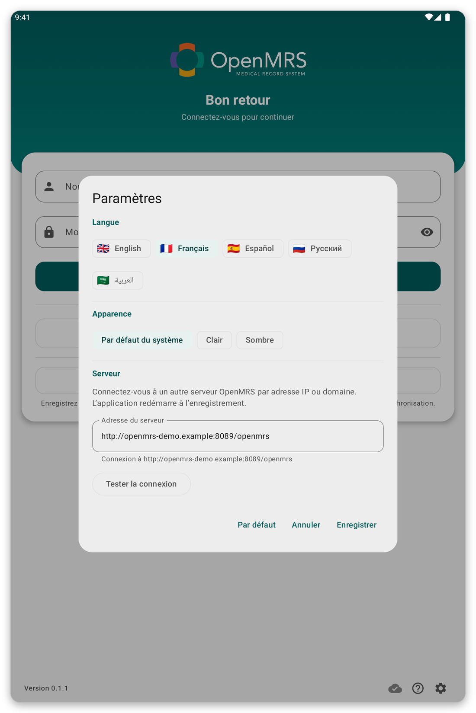

# Dépannage {#troubleshooting}

Pour chaque problème, vous trouvez pourquoi il arrive et ce qu'il faut faire.

## Je n'arrive pas à me connecter au serveur {#cannot-connect}

**Pourquoi :** la tablette n'a pas internet, le serveur est arrêté, ou l'adresse du serveur dans les paramètres est fausse.

*Figure 1 : Les paramètres de la page de connexion : langue, apparence et adresse du serveur.*

**Que faire :**

1. Vérifiez que le Wi-Fi ou les données mobiles sont activés, et ouvrez une page web pour tester.
2. Dans les paramètres de la page de connexion, ou dans {{settings}}, touchez {{test_connection}}.
3. Si le test échoue, demandez à votre organisation si le serveur fonctionne et si l'adresse est bonne.

Vous pouvez continuer à travailler hors connexion : votre travail est gardé et envoyé plus tard.

## Mon mot de passe est refusé {#password-refused}

**Pourquoi :** le mot de passe est faux, ou votre compte utilise seulement l'authentification unique.

**Que faire :** écrivez-le de nouveau, lentement. Si la page propose {{sign_in_with_sso}}, essayez cela. Si cela échoue encore, demandez à votre organisation de le réinitialiser.

## La page d'authentification unique ne s'ouvre pas ou ne revient pas à l'application {#sso-fails}

**Pourquoi :** il n'y a pas de connexion, ou le navigateur a été fermé avant la fin.

**Que faire :** touchez de nouveau {{sign_in_with_sso}} et terminez la connexion sans fermer l'onglet du navigateur.

## Les listes de patients ne se chargent pas {#lists-fail}

**Pourquoi :** pas de connexion, ou aucune liste n'est reliée à votre lieu.

**Que faire :** touchez {{patient_lists_try_again}}. Ou touchez {{patient_lists_continue_without}} et choisissez les listes plus tard (voir [Lieu et listes de patients](#location-and-lists)).

## Un patient manque {#patient-missing}

**Pourquoi :** sa liste de patients n'est pas sélectionnée, ou le patient a été enregistré par un autre utilisateur de la tablette.

**Que faire :** choisissez sa liste (voir [Lieu et listes de patients](#location-and-lists)). Avec le mode en direct activé, cherchez sur le serveur (voir [Synchronisation et mode en direct](#sync)).

## La synchronisation échoue ou ne se termine pas {#sync-fails}

**Pourquoi :** la connexion est faible ou a été perdue, ou la session a expiré.

**Que faire :** ouvrez la page de synchronisation et l'historique pour voir comment elle s'est terminée. Allez là où le signal est meilleur et touchez {{sync_now}}. Si une bande demande de vous reconnecter, touchez {{sign_in}}. Votre travail n'est jamais perdu par une synchronisation qui échoue.

## La tablette demande mon empreinte et échoue {#unlock-fails}

**Pourquoi :** l'empreinte ou le verrouillage d'écran a changé, donc la connexion hors ligne a été désactivée.

**Que faire :** connectez-vous avec votre compte, puis réactivez la connexion hors ligne dans {{settings}}.

## Quelque chose ne va pas et l'assistance demande des détails {#send-report}

Ouvrez le menu, touchez {{send_diagnostics}} et suivez les étapes (voir [Sécurité, utilisateurs et vos données](#diagnostics)).
