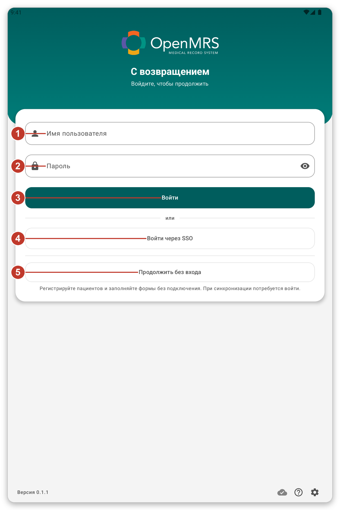
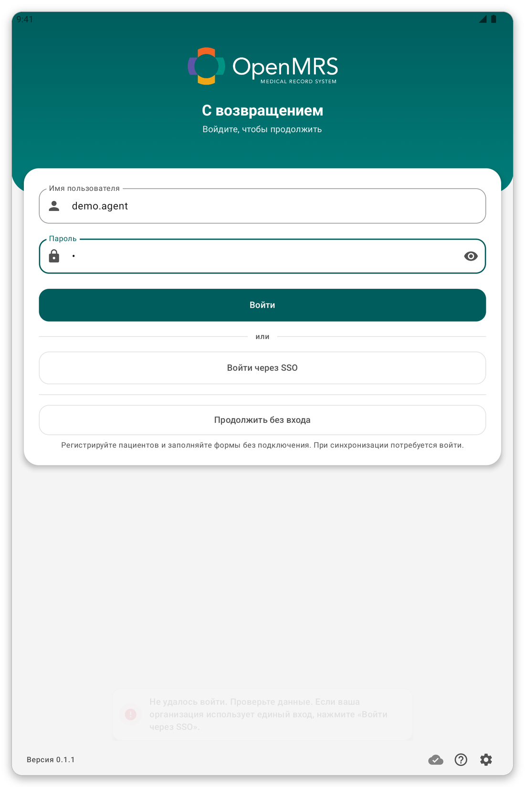
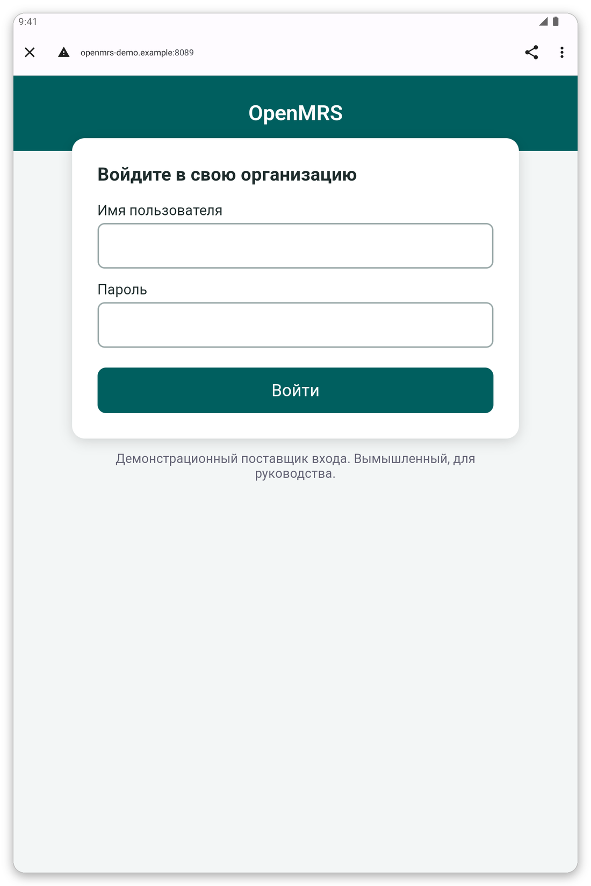
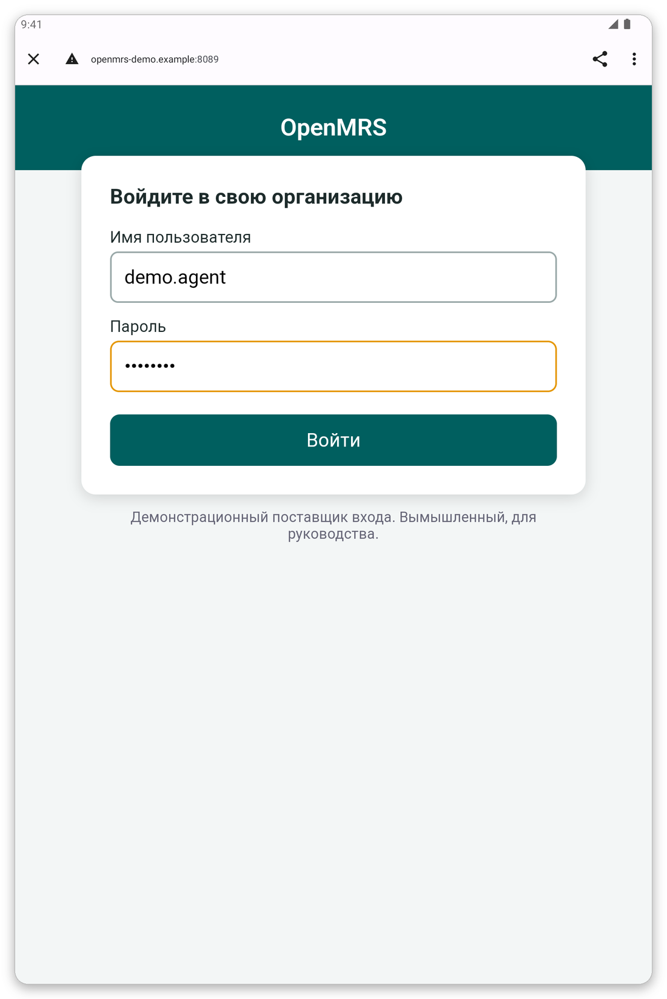
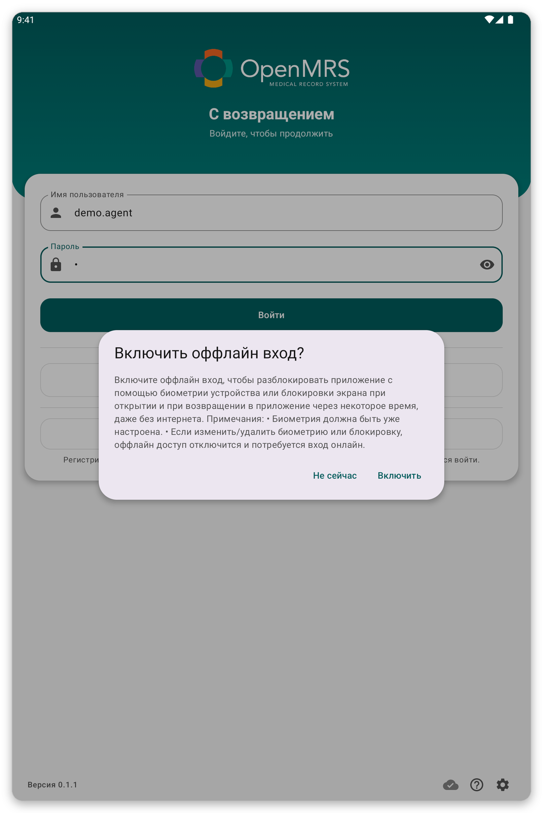
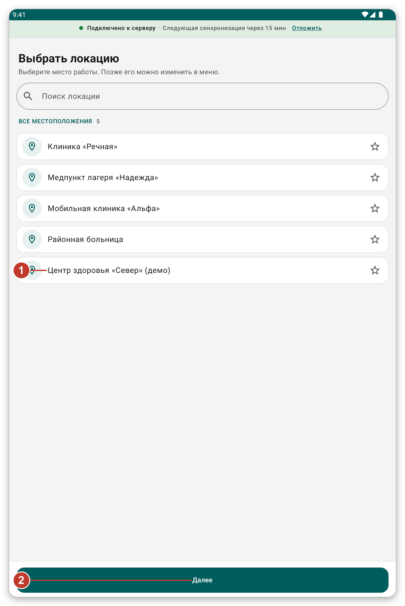
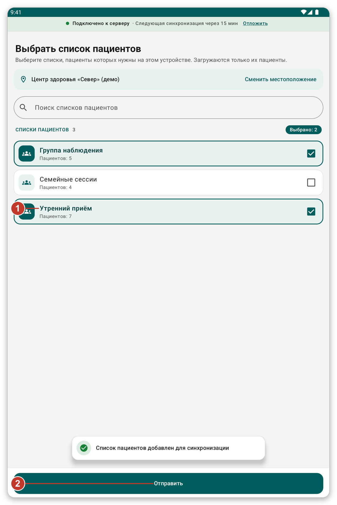
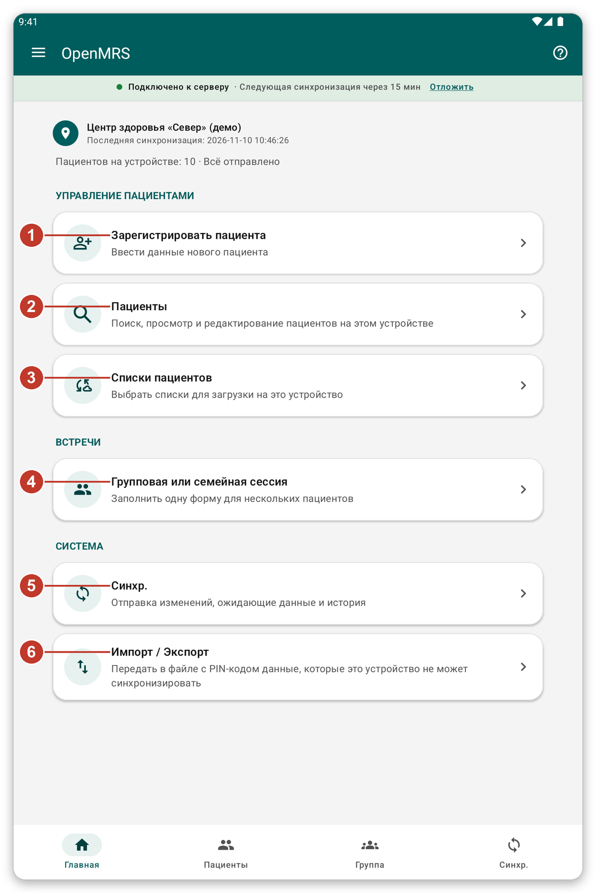

# Первые шаги {#getting-started}

## Установка и первый запуск {#install}

**Для чего это нужно:** установить приложение на планшет и открыть его в первый раз.

**Перед началом:** приложение предоставляет ваша организация. <!-- TODO: verify how the app is distributed (app file or store) -->

1. Установите приложение на планшет так, как вам сказала организация.
2. Откройте приложение. Появится страница входа.
3. Если Android спросит разрешение на уведомления, нажмите **Разрешить**. Приложение использует уведомления, чтобы сообщить, что идёт синхронизация.

> **Совет:** маленькие значки внизу страницы входа открывают настройки страницы (язык, оформление и сервер) и запускают короткий обзор.

## Вход в приложение {#sign-in}

**Для чего это нужно:** подтвердить, кто вы, чтобы приложение могло загрузить ваших пациентов.

**Перед началом:** нужно подключение к интернету.

*Рисунок 1: страница входа.*

1. Введите имя пользователя в поле {{username}} (1).
2. Введите пароль в поле {{password}} (2).
3. Нажмите {{button_login}} (3).

Если ваша организация использует единый вход или разрешает работать без учётной записи, вы также увидите {{sign_in_with_sso}} (4) и {{continue_without_login}} (5).

> **Внимание:** если пароль неверный, появится сообщение, и вы останетесь на этой же странице. Проверьте пароль и попробуйте снова. После нескольких неудачных попыток попросите организацию сбросить пароль.

*Рисунок 2: после неверного пароля вы остаётесь на странице входа и можете попробовать ещё раз.*

### Вход через единый вход {#sso}

Единый вход позволяет использовать учётную запись, которую вам уже выдала организация.

1. Нажмите {{sign_in_with_sso}}. В браузере откроется страница входа вашей организации.
2. Введите на этой странице имя пользователя и пароль.
3. Нажмите **Войти**. Приложение откроется снова само.

*Рисунок 3: страница входа вашей организации. В каждой организации она выглядит по-своему.*

*Рисунок 4: введите имя пользователя и пароль, затем нажмите зелёную кнопку.*

> **Примечание:** страница в браузере принадлежит вашей организации, а не приложению. Если она не открывается, проверьте подключение и попробуйте ещё раз.

### Работа без учётной записи {#guest}

Если организация разрешает, нажмите {{continue_without_login}}. Вы сможете регистрировать пациентов и заполнять формы без связи. Приложение попросит вас войти при синхронизации и сохранит всё, что вы записали.

## Вход без подключения {#offline-login-prompt}

После первого входа приложение спрашивает, хотите ли вы разблокировать его отпечатком пальца, лицом или блокировкой экрана, даже без подключения.

*Рисунок 5: вопрос о входе без подключения.*

- Нажмите {{enable_offline_login_positive}}, чтобы включить. На устройстве уже должны быть настроены отпечаток, лицо или блокировка экрана.
- Нажмите {{enable_offline_login_negative}}, чтобы пропустить. Позже это можно изменить в настройках.

## Выбор места работы {#choose-location}

*Рисунок 6: выберите место, где вы работаете.*

1. Нажмите на своё место в списке (1). Звёздочка позволяет держать избранные места вверху.
2. Нажмите {{next}} (2).

> **Примечание:** всё, что вы регистрируете и записываете, сохраняется за этим местом. Позже его можно сменить в меню.

## Выбор списков пациентов {#choose-lists}

*Рисунок 7: отметьте списки, пациенты которых вам нужны.*

1. Отметьте нужные списки (1). Число показывает, сколько пациентов в каждом списке.
2. Нажмите {{submit}} (2).

Теперь приложение загрузит этих пациентов. **Дождитесь конца загрузки.** Эту первую загрузку нельзя пропустить, и она может занять несколько минут. Оставайтесь подключёнными к Wi-Fi или мобильным данным и держите планшет там, где хороший сигнал.

## Главный экран {#first-home}

Когда загрузка закончится, появится главный экран. В первый раз короткий обзор покажет вам приложение. Нажмите {{tutorial_skip}}, если он не нужен. Обзор можно запустить снова в любое время кнопкой **?**.

*Рисунок 8: главный экран. Каждый номер объясняется в следующей главе.*

## Если что-то пошло не так {#getting-started-problems}

- Страница входа сообщает, что не удалось подключиться: см. [Устранение неполадок](#cannot-connect).
- Списки пациентов не загружаются: нажмите {{patient_lists_try_again}} или см. [Устранение неполадок](#lists-fail).
