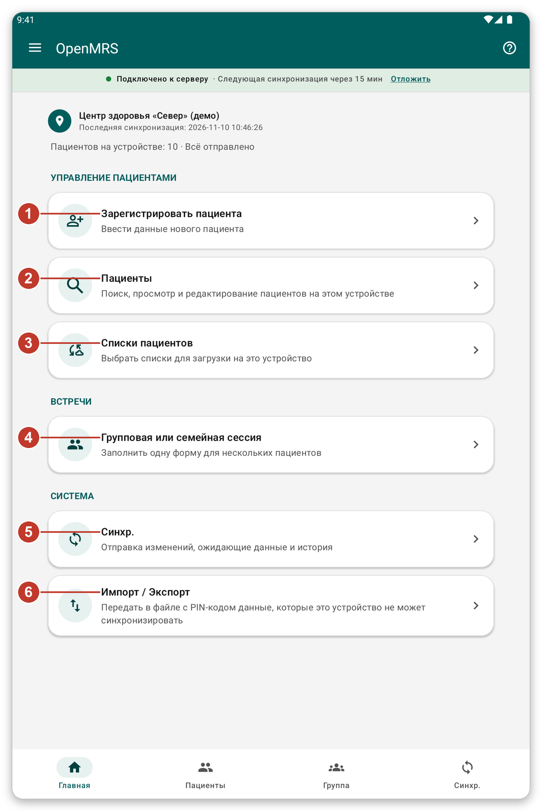
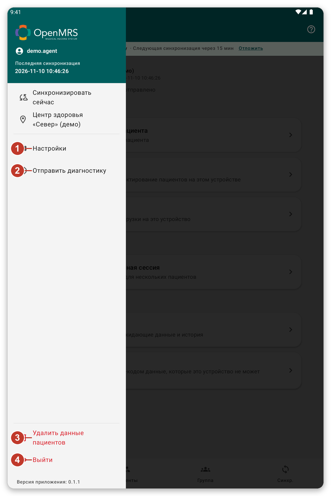

# Как ориентироваться в приложении {#navigation}

## Для чего это нужно {#nav-purpose}

Эта глава показывает основные части экрана, чтобы вы всегда знали, где находитесь и как вернуться.

## Главный экран {#home-screen}

*Рисунок 1: главный экран.*

Вверху вы видите, где вы работаете, когда данные синхронизировались в последний раз и сколько пациентов на планшете. Ниже находятся кнопки:

1. {{title_add_patient}}: ввести данные нового пациента.
2. {{nav_patients}}: искать, открывать и изменять пациентов на планшете.
3. {{patient_lists_header}}: выбрать, какие списки пациентов хранить на планшете.
4. {{title_group_encounter}}: заполнить одну форму для нескольких пациентов.
5. {{nav_sync}}: отправить вашу работу и загрузить свежие данные.
6. {{title_import_export}}: передать в защищённом файле данные, которые нельзя синхронизировать.

## Нижняя панель {#bottom-bar}

Четыре кнопки внизу основных экранов ведут прямо на {{nav_home}}, {{nav_patients}}, {{nav_group_session}} и {{nav_sync}}. Текущий раздел подсвечен.

## Меню {#menu}

Нажмите на три линии вверху слева, чтобы открыть меню.

*Рисунок 2: меню.*

1. {{settings}}: сменить язык, оформление, безопасность, формы и параметры синхронизации.
2. {{send_diagnostics}}: подготовить отчёт для службы поддержки.
3. {{delete_patient_data_menu}}: удалить с планшета пациентов вашей учётной записи. Сначала попросит подтвердить.
4. {{logout}}: выйти из учётной записи.

Место, где вы работаете, тоже есть в меню. Нажмите на него, чтобы выбрать другое место.

## Полоса под заголовком {#connection-strip}

Цветная полоса под заголовком сообщает о подключении: {{network_status_connected_to_server}} означает, что планшет может связаться с сервером. Если там сказано, что сервер недоступен, вы всё равно можете работать. Ваша работа сохраняется на планшете и отправляется позже.

## Справка на каждом экране {#help-tour}

Кнопка **?** справа вверху запускает короткий обзор текущего экрана. Каждый шаг объясняет одну кнопку. Нажмите {{tutorial_skip}}, чтобы остановить.

> **Совет:** нельзя запустить обзор во время синхронизации. Дождитесь её окончания.

## Если что-то пошло не так {#nav-problems}

- Вы запутались: нажмите стрелку назад вверху слева или {{nav_home}} на нижней панели.
- Кнопка серая: сейчас она недоступна. Например, {{nav_sync}} в меню серая, когда сервер недоступен.
