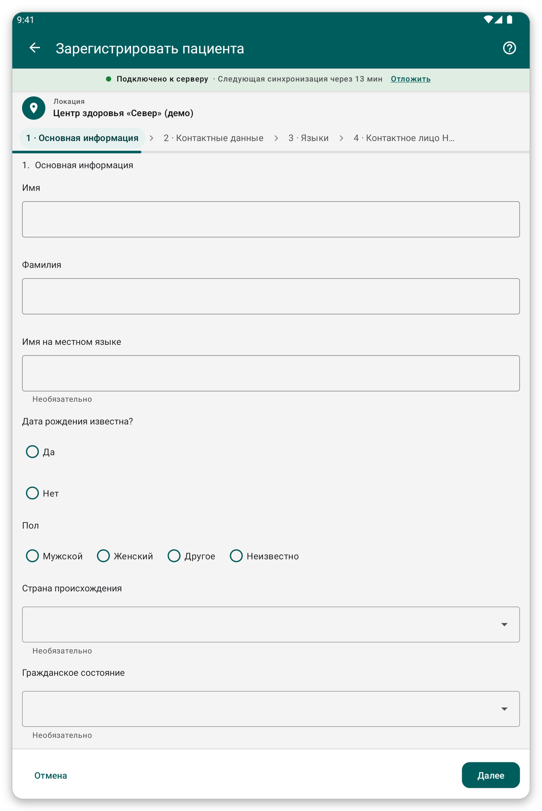

# Регистрация пациента {#register-patient}

## Для чего это нужно {#register-purpose}

Добавить в приложение нового пациента с его именем, возрастом, полом и контактными данными.

## Перед началом {#register-before}

- Убедитесь, что пациента ещё нет в приложении: сначала поищите (см. [Поиск и открытие пациента](#find-patient)).
- Сначала выберите свою локацию, потому что пациент сохраняется за ней.

## Шаг за шагом {#register-steps}

*Рисунок 1: первая страница регистрационной формы.*

1. На главном экране нажмите {{title_add_patient}}.
2. Отвечайте на вопросы страница за страницей. На обязательные вопросы нужно ответить, прежде чем идти дальше.
3. Нажмите {{button_pagination_next}}, чтобы перейти на следующую страницу, и {{button_pagination_previous}}, чтобы вернуться. Можно также нажать на название страницы вверху и перейти прямо на неё.
4. В конце нажмите {{button_review}} и проверьте ответы.
5. Нажмите {{submit}}, чтобы сохранить пациента.

После сохранения приложение открывает карточку пациента.

> **Внимание:** пациента нельзя сохранить, пока не даны обязательные ответы. Недостающие ответы отмечены красным.

## Советы {#register-tips}

- Если вы не знаете дату рождения, в форме можно ввести возраст.
- Без связи пациент сохраняется на планшете и отправляется при следующей синхронизации.
- Если пациент, скорее всего, уже есть на сервере, но не на вашем планшете, не регистрируйте его снова: используйте {{identify_later_action}} (см. [Опознать позже](#identify-later)).

## Если что-то пошло не так {#register-problems}

- Нельзя перейти на следующую страницу: не хватает обязательного ответа. Найдите красную отметку.
- Вы ошиблись после сохранения: откройте пациента и нажмите {{edit_patient}} (см. [Карточка пациента](#patient-file)).
