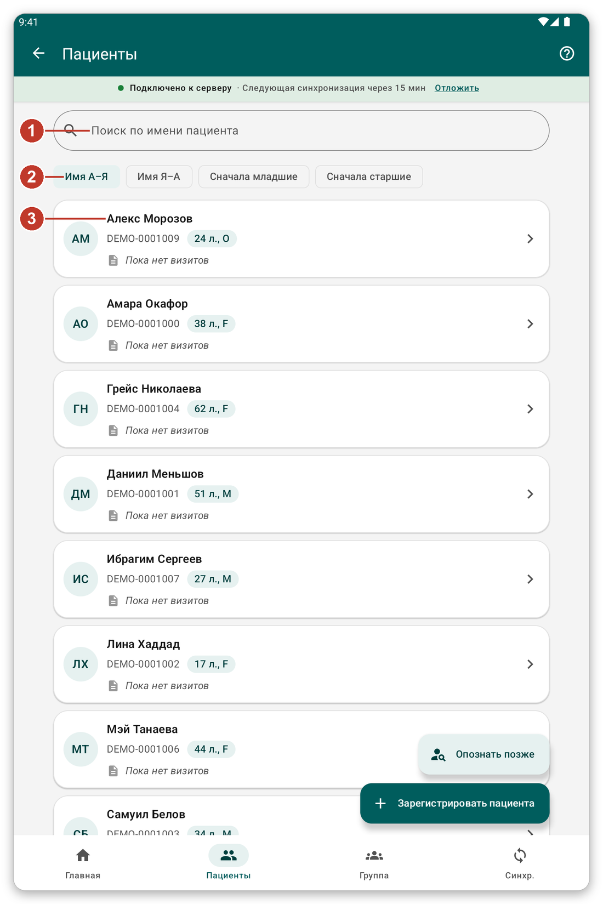
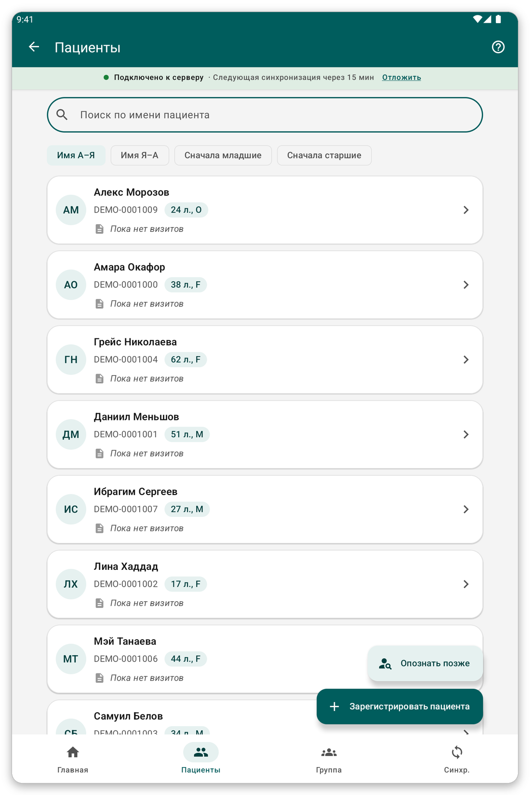
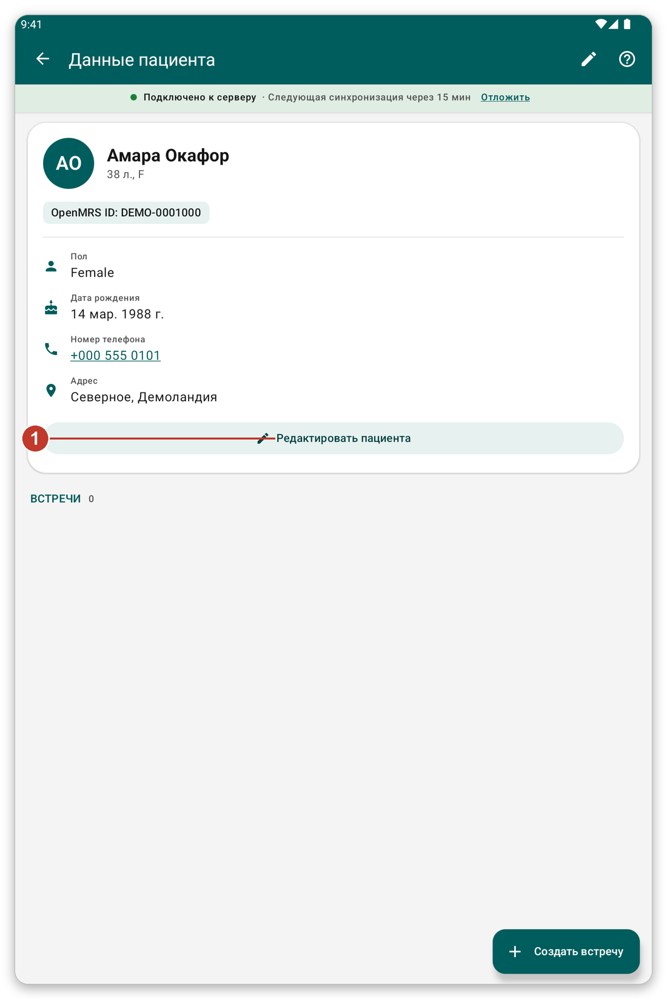

# Поиск и открытие пациента {#find-patient}

## Для чего это нужно {#find-purpose}

Найти пациента на планшете, открыть его карточку и исправить данные.

## Перед началом {#find-before}

Пациент должен быть в выбранном вами списке пациентов или зарегистрирован на этом планшете.

## Шаг за шагом {#find-steps}

*Рисунок 1: список пациентов.*

1. Нажмите {{nav_patients}} на нижней панели.
2. Введите имя, номер идентификатора или номер телефона в строку поиска (1).
3. Выберите порядок кнопками под ней (2): {{patient_sort_name_asc}}, {{patient_sort_name_desc}}, {{patient_sort_age_youngest}} или {{patient_sort_age_oldest}}.
4. Нажмите на пациента (3), чтобы открыть его карточку.

*Рисунок 2: если ввести часть имени, остаются только подходящие пациенты.*

Список показывает по 100 пациентов. Нажмите кнопку в конце списка, чтобы увидеть остальных. Пациенты, с которыми вы работали последними, стоят первыми в разделе {{recent_patients_title}}.

## Карточка пациента {#patient-file}

*Рисунок 3: карточка пациента.*

В карточке видны имя, возраст, идентификатор и контактные данные. Ниже {{header_encounters}} перечисляют всё, что записано для пациента.

1. Нажмите {{edit_patient}} (1), чтобы изменить регистрационные данные.
2. Потяните страницу вниз, чтобы заново прочитать карточку с сервера (при наличии связи).
3. Нажмите на номер телефона, чтобы позвонить.
4. Зелёная кнопка внизу позволяет записать что-то новое (см. [Запись встречи](#record-encounter)).

## Опознать позже {#identify-later}

Иногда пациент уже есть на сервере, но не на вашем планшете, а связи нет. Не регистрируйте его снова: это создаст дубликат.

1. В списке пациентов нажмите {{identify_later_action}}.
2. Введите заметку, которая поможет позже найти пациента (имя, деревня, телефон).
3. Запишите визит как обычно.
4. Позже, при наличии связи, откройте пациента и нажмите {{identify_banner_identify}}, чтобы найти настоящего пациента на сервере. Всё записанное перейдёт к нему.

> **Внимание:** данные пациента, которого нужно опознать позже, не отправляются при синхронизации, пока вы его не опознаете. Перед синхронизацией приложение спросит о таких пациентах.

## Советы {#find-tips}

- Маленький значок облака у пациента означает, что его последние изменения ещё не отправлены.
- При включённом режиме онлайн можно искать и на сервере (см. [Синхронизация и режим онлайн](#live-mode)).

## Если что-то пошло не так {#find-problems}

- Пациента нет: проверьте, что его список пациентов выбран (см. [Списки пациентов](#patient-lists)).
- Данные устарели: потяните страницу вниз, чтобы обновить, или синхронизируйте.
