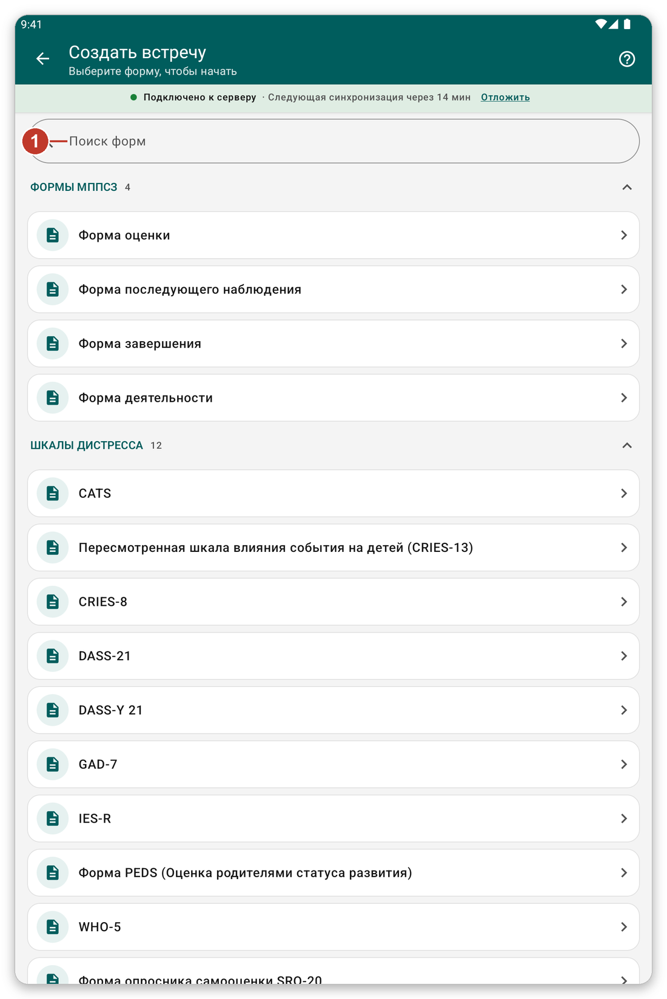

# Запись встречи с помощью формы {#record-encounter}

## Для чего это нужно {#encounter-purpose}

Записать, что вы сделали для пациента, заполнив форму, например шкалу скрининга или оценку.

## Перед началом {#encounter-before}

Откройте карточку пациента (см. [Поиск и открытие пациента](#find-patient)).

## Шаг за шагом {#encounter-steps}

1. В карточке пациента нажмите {{create_encounter}} (зелёная кнопка внизу).
2. Откроется список форм. Формы собраны в **разделы**, например **Формы МППСЗ**, **Шкалы дистресса** и **Шкалы функционирования**. Нажмите на название раздела, чтобы свернуть или развернуть его.
3. Чтобы быстро найти форму, введите часть её названия в {{search_forms}}.
4. Нажмите на нужную форму.

*Рисунок 1: выберите форму. Разделы заданы в настройках приложения.*

5. Отвечайте на вопросы. В форме может быть несколько страниц. Используйте {{button_pagination_next}} и {{button_pagination_previous}} или нажмите на название страницы вверху.
6. Закончив, нажмите {{button_review}} и проверьте ответы.
7. Нажмите {{submit}}.

Сохранённое остаётся на планшете и отправляется при следующей синхронизации. При включённом режиме онлайн оно отправляется через мгновение.

> **Внимание:** ответы, отмеченные как **обязательные**, нужно заполнить, прежде чем идти дальше.

## Просмотр и изменение встречи {#edit-encounter}

В карточке пациента нажмите на название встречи, чтобы прочитать её. Нажмите на карандаш, чтобы изменить.

## Выбор разделов, которые вы видите {#form-sections}

Разделы берутся из настроек вашей организации. Можно создать свои: откройте {{settings}}, перейдите в {{settings_section_forms_visits}} и нажмите {{form_sections_customize}} (см. [Настройки](#settings)).

## Если что-то пошло не так {#encounter-problems}

- Нужной формы нет в списке: посмотрите в других разделах или найдите её по названию. Если её всё равно нет, спросите свою организацию.
- Форма сообщает, что ответ обязателен: прокрутите до красного сообщения и ответьте.
