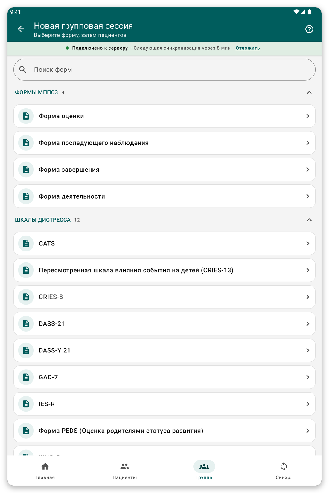

# Групповые сессии и визиты {#group-and-visits}

## Групповая или семейная сессия {#group-session}

**Для чего это нужно:** заполнить одну форму сразу для нескольких пациентов, например для семьи или группы.

**Перед началом:** пациенты должны быть на планшете.

*Рисунок 1: начните групповую сессию, выбрав форму.*

1. Нажмите {{title_group_encounter}} на главном экране или {{nav_group_session}} на нижней панели.
2. Выберите форму.
3. Выберите пациентов сессии.
4. Отвечайте на вопросы. У каждого пациента вверху своя вкладка со своими ответами.
5. Проверьте и сохраните.

> **Совет:** начатая и незавершённая сессия сохраняется, чтобы её можно было продолжить.

## Визиты {#visits}

Визит — это период оказания помощи, в котором одна или несколько встреч.

По умолчанию приложение само создаёт визит для каждой встречи. Вы визитов не видите, а карточка пациента — это простой список встреч.

Если ваша организация хочет, чтобы вы управляли визитами сами (параметр {{settings_automatic_visits}} выключен):

1. В карточке пациента нажмите {{start_visit}}, чтобы открыть визит. Приложение спросит, когда он начался.
2. Записывайте встречи визита.
3. Нажмите {{end_visit}}, когда визит закончен. Нажмите {{reopen_visit}}, чтобы открыть его снова.

> **Примечание:** одновременно может быть открыт только один визит. Встреча должна попадать в период своего визита.

## Если что-то пошло не так {#group-problems}

- Пациента нет в сессии: его нет на планшете. Сначала выберите его список пациентов (см. [Списки пациентов](#patient-lists)).
- Приложение не сохраняет встречу в визите: её дата выходит за рамки визита. Измените дату или визит.
