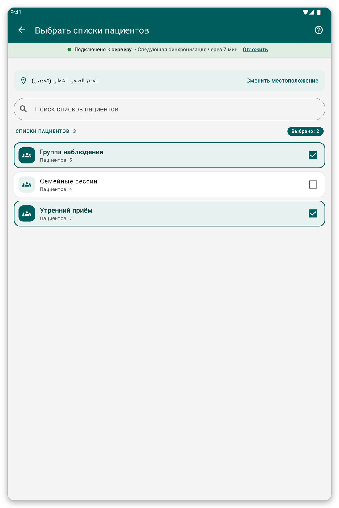

# Локация и списки пациентов {#location-and-lists}

## Для чего это нужно {#lists-purpose}

Выбрать место, где вы работаете, и списки пациентов, которых вы храните на планшете.

## Смена локации {#change-location}

1. Откройте меню и нажмите на название вашей локации.
2. Введите часть названия в {{search_a_location}} или прокрутите список.
3. Нажмите на нужное место.

Места, отмеченные звёздочкой, идут первыми.

## Смена списков пациентов {#patient-lists}

*Рисунок 1: отметьте списки, которые нужны на планшете.*

1. На главном экране нажмите {{patient_lists_header}}.
2. Введите часть названия в {{search_patient_lists}}, чтобы найти список.
3. Отметьте нужные списки. Их пациенты сразу загрузятся.
4. Нажмите {{submit}}.

> **Внимание:** если не отмечен ни один список, пациенты не загружаются.

## Если что-то пошло не так {#lists-load-problems}

- Списки не загружаются: проверьте подключение и нажмите {{patient_lists_try_again}}. Можно также нажать {{patient_lists_continue_without}} и выбрать списки позже.
- Нет мест для выбора: организация не связала места с вашей учётной записью. Обратитесь к ней.
