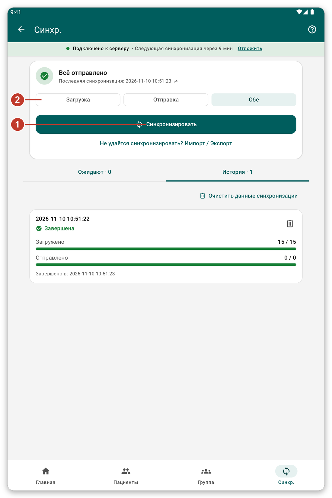

# Синхронизация и режим онлайн {#sync}

## Для чего это нужно {#sync-purpose}

**Синхронизация** отправляет на сервер то, что вы записали на планшете, и приносит свежие данные. Пока вы не синхронизируете, ваша работа в безопасности только на планшете.

## Перед началом {#sync-before}

Нужно подключение к серверу. Если вы работаете как гость, приложение сначала попросит вас войти.

## Шаг за шагом {#sync-steps}

*Рисунок 1: страница синхронизации.*

1. Нажмите {{nav_sync}} на нижней панели.
2. Вверху видно, ждёт ли что-то отправки и когда данные синхронизировались в последний раз.
3. Выберите, что делать в этот раз, тремя кнопками (2): {{sync_page_mode_download}}, {{sync_page_mode_upload}} или {{sync_page_mode_both}}. Этот выбор действует только для этой синхронизации.
4. Нажмите {{sync_now}} (1). Пока она идёт, приложением можно пользоваться.
5. Чтобы остановить её, нажмите {{sync_cancel}}.

Ниже {{sync_tab_pending}} показывает то, что ещё не отправлено, а {{sync_tab_history}} — прошлые синхронизации и чем они закончились.

> **Внимание:** по возможности не удаляйте данные пациентов и не выходите из учётной записи, пока всё не отправлено. Убедитесь, что на главном экране написано {{home_summary_uploaded}}.

## Автоматическая синхронизация {#automatic-sync}

Приложение может синхронизироваться само время от времени. Оно ждёт подходящего момента, например когда планшет подключён к Wi-Fi и батарея не разряжена. Это можно изменить в {{settings}} (см. [Настройки](#settings)). Полоса под заголовком показывает, когда начнётся следующая синхронизация. Нажмите {{auto_sync_delay_link}}, чтобы отложить её.

## Режим онлайн {#live-mode}

Когда {{settings_live_mode}} включён, всё, что вы сохраняете, сразу отправляется на сервер, и можно искать на сервере пациентов, которых нет на планшете. Без связи ничего не теряется: ваша работа сохраняется и отправляется позже.

Включите его в {{settings}}, в разделе {{settings_section_live}}.

## Сессия истекла {#session-expired}

Если сервер больше не принимает ваш вход, под состоянием подключения появляется полоса. Нажмите {{sign_in}}. То, что вы сделали за это время, остаётся на планшете и отправляется позже.

## Если что-то пошло не так {#sync-problems}

- Синхронизация не начинается: сервер недоступен. Проверьте подключение (см. [Устранение неполадок](#cannot-connect)).
- Синхронизация не удалась: откройте {{sync_tab_history}}, чтобы увидеть, чем она закончилась, и повторите. Ваша работа не потеряна.
- Приложение спрашивает о пациентах, которых нужно опознать: выберите опознать их сейчас или всё равно синхронизировать (см. [Опознать позже](#identify-later)).
