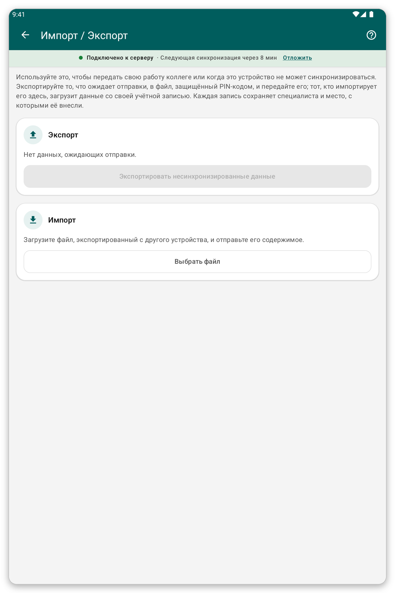

# Импорт и экспорт {#import-export}

## Для чего это нужно {#ie-purpose}

Если планшет не может синхронизироваться, неотправленные данные можно передать коллеге в файле, защищённом PIN-кодом. Коллега импортирует файл и отправляет его со своей учётной записи.

## Перед началом {#ie-before}

- На планшете, который экспортирует, должны быть данные, ожидающие отправки.
- Оба человека должны договориться о четырёхзначном PIN-коде.

*Рисунок 1: страница импорта и экспорта.*

## Экспорт файла {#export}

1. На главном экране нажмите {{title_import_export}}.
2. Нажмите {{export_title}}.
3. Введите или выберите четырёхзначный PIN-код. <!-- TODO: verify whether the app asks for the PIN or generates it -->
4. Сохраните файл или поделитесь им, как предлагает приложение.

## Импорт файла {#import}

1. На главном экране нажмите {{title_import_export}}.
2. Нажмите {{import_title}} и выберите файл.
3. Введите PIN-код.
4. Приложение сохранит записи. Затем синхронизируйте, чтобы их отправить.

> **Внимание:** повторный импорт того же файла ничего не делает, поэтому дубликаты не создаются. Если включён режим онлайн, работа уже отправлена, и экспортировать, возможно, нечего.

## Если что-то пошло не так {#ie-problems}

- PIN-код отклонён: попросите отправителя подтвердить четыре цифры.
- Некоторые записи не сохранены: в отчёте сказано, какие и почему. Изменение пациента можно сохранить, только если этот пациент уже есть на вашем планшете.
