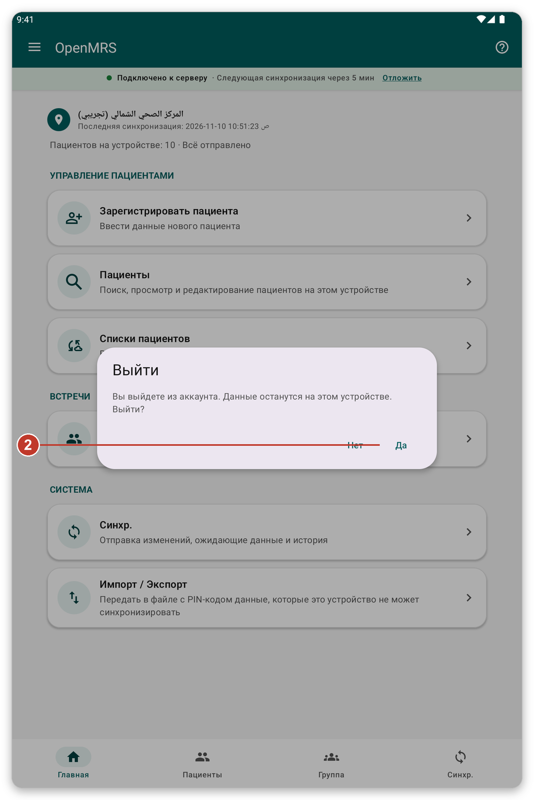
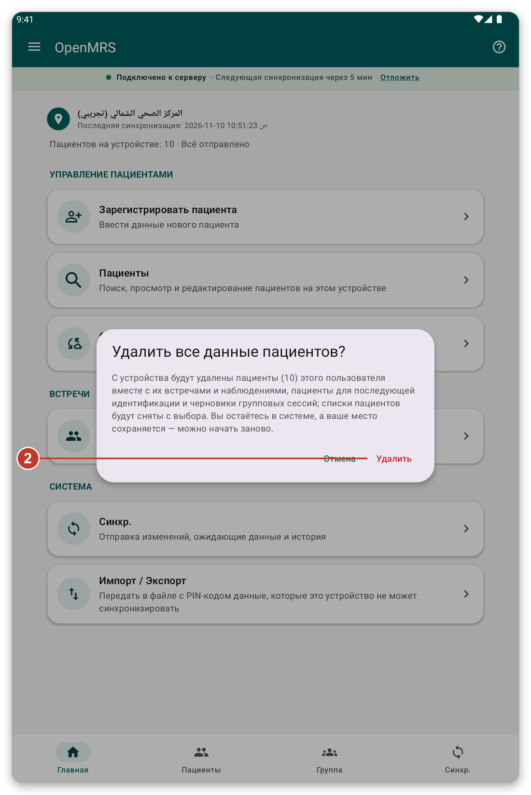
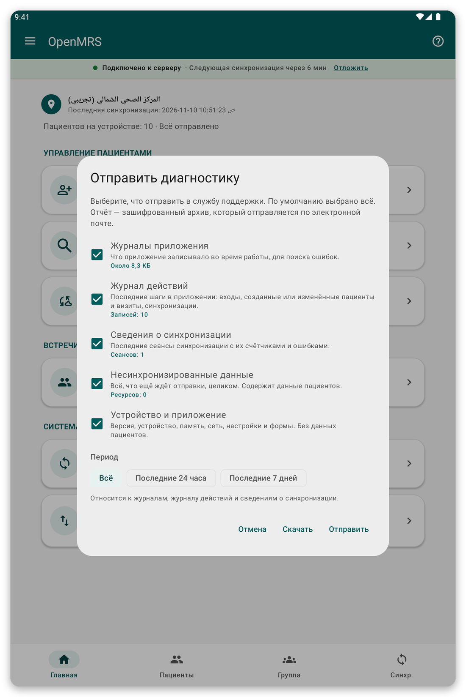

# Безопасность, пользователи и ваши данные {#security}

## Вход без подключения и экран блокировки {#lock-screen}

Если вы включили {{offline_login_title}}, приложение блокируется, когда вы возвращаетесь к нему через какое-то время. Вы разблокируете его отпечатком пальца, лицом или блокировкой экрана, даже без подключения. Как долго приложение ждёт, прежде чем запросить это снова, можно выбрать в {{settings}}.

> **Внимание:** если вы измените или удалите отпечаток или блокировку экрана на планшете, вход без подключения отключится, и вам придётся снова войти в учётную запись.

## Несколько человек на одном планшете {#several-users}

По умолчанию при выходе ваши данные остаются на планшете, и следующий человек их находит.

- Вы видите только тех пациентов, которых зарегистрировали или загрузили. Другие пользователи их не видят, если вы не разрешите это в {{settings}} ({{settings_share_my_data}}).
- У каждого пользователя свои списки пациентов и своя локация.
- На странице входа маленький значок облака показывает, есть ли у каких-то пользователей данные, ожидающие отправки. Нажмите на него, чтобы увидеть их, затем нажмите {{login_pending_use_user}}, чтобы подставить имя пользователя.

## Выход {#log-out}

*Рисунок 1: при выходе приложение просит подтвердить.*

1. Откройте меню и нажмите {{logout}}.
2. Прочитайте сообщение. В нём сказано, что будет с вашими данными.
3. Нажмите {{yes}}, чтобы выйти, или {{no}}, чтобы остаться.

## Удаление данных пациентов {#delete-data}

Это удаляет с планшета пациентов вашей учётной записи вместе с их встречами, чтобы можно было начать заново. Вы остаётесь в системе и сохраняете свою локацию.

*Рисунок 2: в сообщении сказано, сколько пациентов будет удалено и сколько данных никогда не отправлялось.*

> **Внимание:** данные, которые никогда не отправлялись, будут потеряны навсегда. Сначала синхронизируйте и убедитесь, что показано {{home_summary_uploaded}}.

1. Откройте меню и нажмите {{delete_patient_data_menu}}.
2. Прочитайте, сколько пациентов и неотправленных данных затронуто.
3. Нажмите {{delete}}, чтобы подтвердить, или {{cancel}}, чтобы остановиться. Если включён вход без подключения, у вас попросят отпечаток пальца или блокировку экрана.

## Отправка диагностики {#diagnostics}

Если служба поддержки попросит, приложение может подготовить отчёт, который помогает найти проблему. Вы сами выбираете, что в него войдёт, и отчёт защищён.

*Рисунок 3: выберите, что включить в отчёт.*

1. Откройте меню и нажмите {{send_diagnostics}}.
2. Выберите, что включить и за какой период.
3. Следуйте шагам, чтобы отправить отчёт по электронной почте. <!-- TODO: verify the exact steps of the e-mail screen -->

> **Примечание:** в отчёте нет ни паролей, ни данных пациентов.

## Если что-то пошло не так {#security-problems}

- Не удаётся разблокировать приложение: нажмите кнопку входа в учётную запись.
- Вы забыли пароль: попросите организацию сбросить его.
