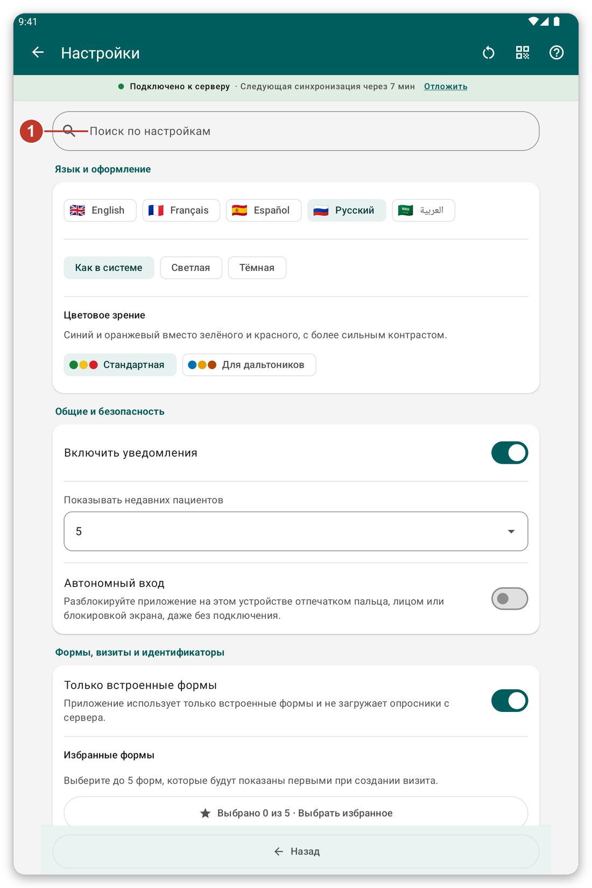
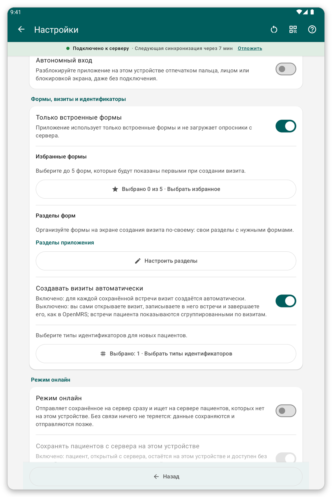
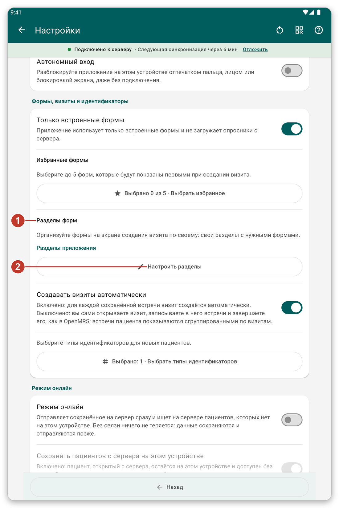
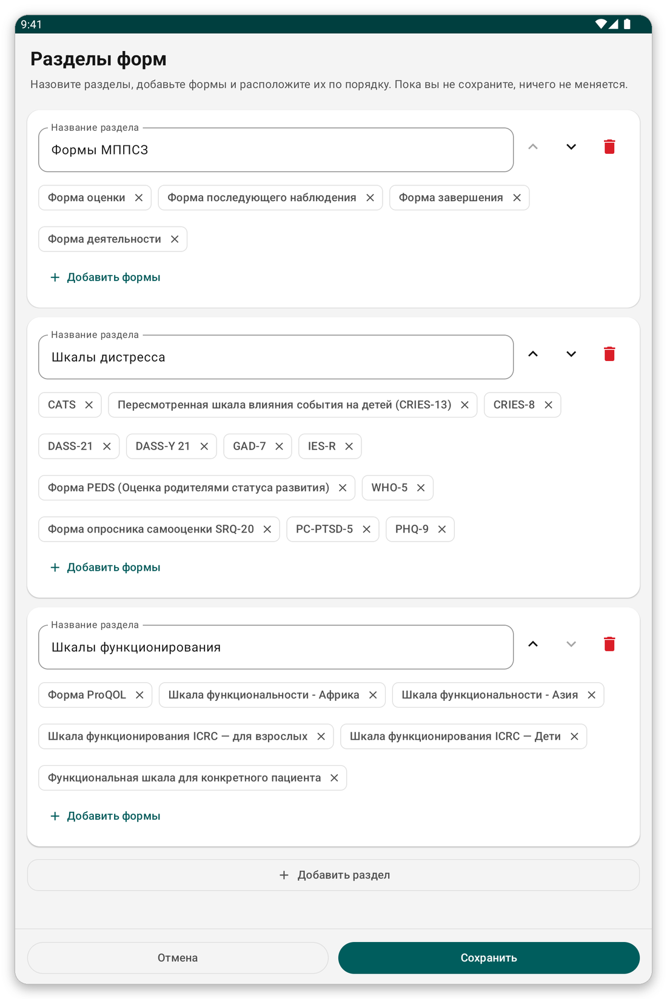

# Настройки {#settings}

Откройте меню и нажмите {{settings}}. Изменения сохраняются сразу.

*Рисунок 1: страница настроек. Введите слово в строку поиска (1), чтобы показать только разделы, где оно встречается.*

## Язык и оформление {#settings-language}

- {{settings_language}}: английский, французский, испанский, русский или арабский. В арабском экраны зеркально отображаются справа налево.
- {{settings_section_appearance}}: светлое, тёмное или системное оформление. Есть также палитра для людей с нарушением цветового зрения.

## Общие и безопасность {#settings-general}

- Уведомления: включены или нет.
- Сколько **недавних пациентов** показывать вверху списка пациентов (0 скрывает раздел).
- Могут ли другие пользователи этого планшета видеть пациентов, которых вы зарегистрировали (по умолчанию выключено).
- Запоминает ли приложение вашу последнюю локацию после входа.
- {{offline_login_title}}: разблокировка отпечатком, лицом или блокировкой экрана, как долго приложение ждёт, прежде чем запросить её снова, скрытие приложения в списке недавних и что происходит с данными при выходе.

*Рисунок 2: Середина страницы настроек с общими параметрами и параметрами безопасности.*

## Формы, визиты и идентификаторы {#settings-forms}

*Рисунок 3: разделы форм (1) и кнопка для их изменения (2).*

- {{favorite_forms}}: выберите до пяти форм, которые показываются первыми.
- {{form_sections_title}}: разделы списка форм. Нажмите {{form_sections_customize}}, чтобы создать свои.
- {{settings_automatic_visits}}: если включено, приложение создаёт визит для каждой встречи; если выключено, вы сами открываете и завершаете визиты.
- **Типы идентификаторов:** какие виды идентификаторов получают новые пациенты.

### Создание собственных разделов форм {#own-sections}

*Рисунок 4: назовите разделы и поместите в них формы. Ничего не изменится, пока вы не сохраните.*

1. Нажмите {{form_sections_customize}}.
2. Измените название раздела, переместите его вверх или вниз либо удалите.
3. Нажмите {{form_section_add_forms}}, чтобы поместить формы в раздел, и {{form_section_add}} для нового раздела.
4. Нажмите {{save}}.

## {{settings_section_live}} {#settings-live}

Отправляйте сохранённое на сервер сразу и ищите на сервере пациентов, которых нет на планшете.

## {{settings_section_sync}} {#settings-sync}

- Адрес сервера и кнопка проверки подключения.
- {{settings_auto_sync}}, что она делает (только отправка или отправка и загрузка) и когда ждёт (только Wi-Fi, низкий заряд батареи).

## Поделиться настройками с другим планшетом {#share-settings}

Значок рядом с заголовком показывает QR-код ваших настроек. На другом планшете выберите импорт и отсканируйте его. Вы увидите, что изменится, и подтвердите. Пациенты, пароли и ваша учётная запись никогда не передаются. <!-- TODO: verify the exact labels of the share and import buttons -->

> **Совет:** если вы изменили много настроек и хотите начать заново, используйте кнопку сброса рядом с заголовком.
