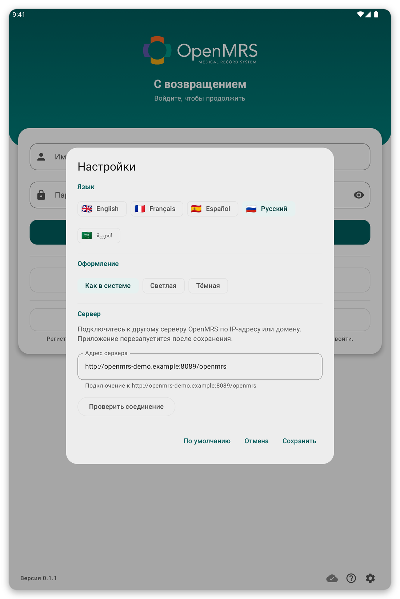

# Устранение неполадок {#troubleshooting}

Для каждой проблемы объясняется, почему она возникает и что делать.

## Не удаётся подключиться к серверу {#cannot-connect}

**Почему:** у планшета нет интернета, сервер не работает или адрес сервера в настройках неверный.

*Рисунок 1: Настройки страницы входа: язык, оформление и адрес сервера.*

**Что делать:**

1. Убедитесь, что Wi-Fi или мобильные данные включены, и откройте любую веб-страницу для проверки.
2. В настройках страницы входа или в {{settings}} нажмите {{test_connection}}.
3. Если проверка не проходит, спросите свою организацию, работает ли сервер и верен ли адрес.

Вы можете продолжать работать без связи: ваша работа сохраняется и отправляется позже.

## Мой пароль не принимается {#password-refused}

**Почему:** пароль неверный, или ваша учётная запись использует только единый вход.

**Что делать:** введите его ещё раз, не торопясь. Если на странице есть {{sign_in_with_sso}}, попробуйте его. Если всё равно не получается, попросите организацию сбросить пароль.

## Страница единого входа не открывается или не возвращает в приложение {#sso-fails}

**Почему:** нет подключения или браузер был закрыт до завершения входа.

**Что делать:** снова нажмите {{sign_in_with_sso}} и завершите вход, не закрывая вкладку браузера.

## Списки пациентов не загружаются {#lists-fail}

**Почему:** нет подключения или ни один список не связан с вашей локацией.

**Что делать:** нажмите {{patient_lists_try_again}}. Или нажмите {{patient_lists_continue_without}} и выберите списки позже (см. [Локация и списки пациентов](#location-and-lists)).

## Пациента нет в списке {#patient-missing}

**Почему:** его список пациентов не выбран, или пациента зарегистрировал другой пользователь планшета.

**Что делать:** выберите его список (см. [Локация и списки пациентов](#location-and-lists)). При включённом режиме онлайн ищите на сервере (см. [Синхронизация и режим онлайн](#sync)).

## Синхронизация не удаётся или не заканчивается {#sync-fails}

**Почему:** слабая связь или она пропала, либо сессия истекла.

**Что делать:** откройте страницу синхронизации и историю, чтобы увидеть, чем она закончилась. Перейдите туда, где сигнал лучше, и нажмите {{sync_now}}. Если полоса просит войти снова, нажмите {{sign_in}}. Неудачная синхронизация никогда не приводит к потере вашей работы.

## Планшет просит отпечаток пальца и не принимает его {#unlock-fails}

**Почему:** отпечаток или блокировка экрана изменились, поэтому вход без подключения был отключён.

**Что делать:** войдите в учётную запись, затем снова включите вход без подключения в {{settings}}.

## Что-то не так, и поддержка просит подробности {#send-report}

Откройте меню, нажмите {{send_diagnostics}} и следуйте шагам (см. [Безопасность, пользователи и ваши данные](#diagnostics)).
